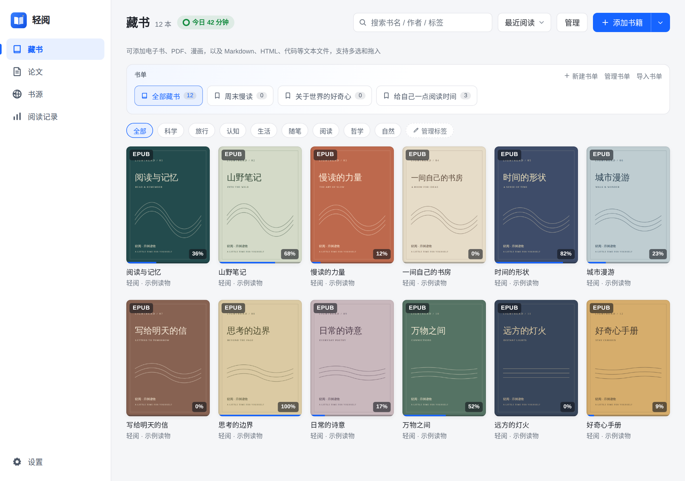
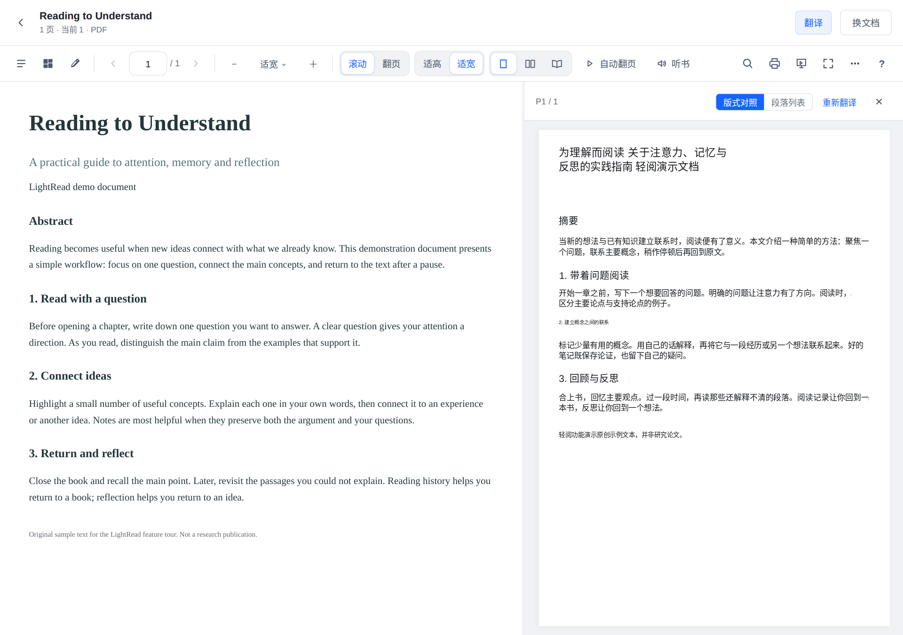
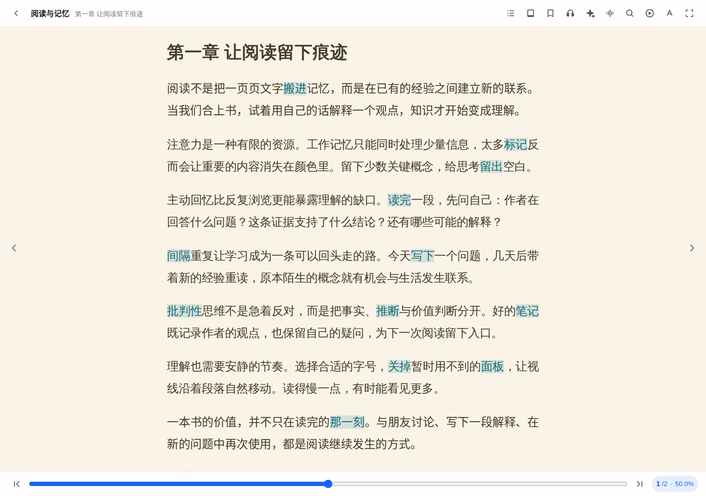
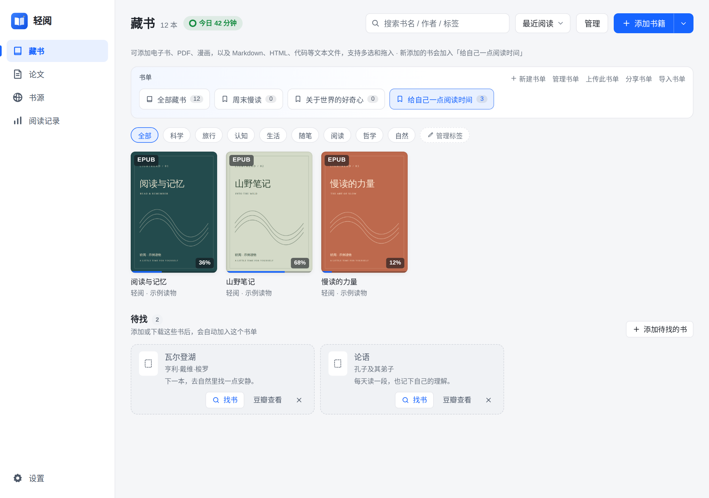
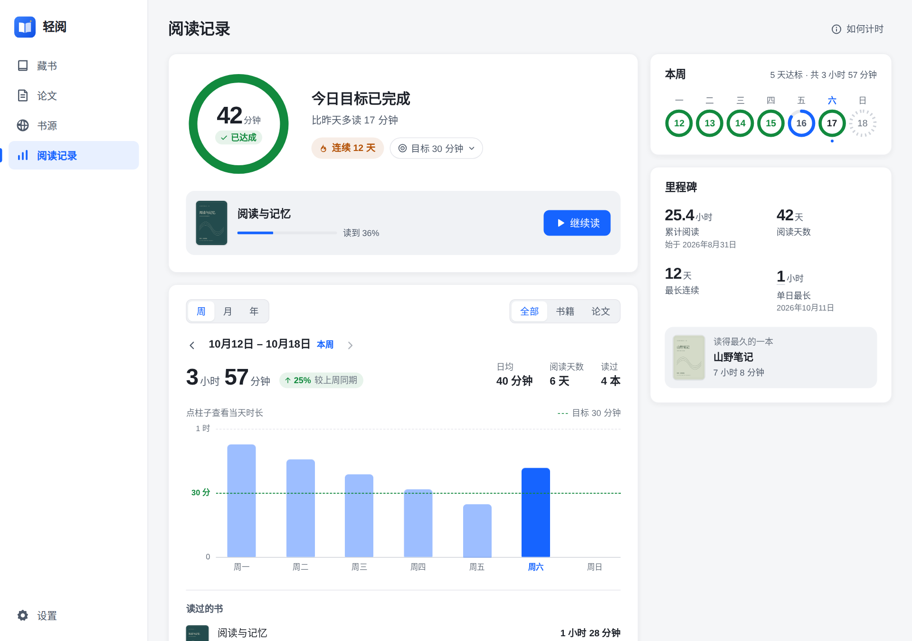
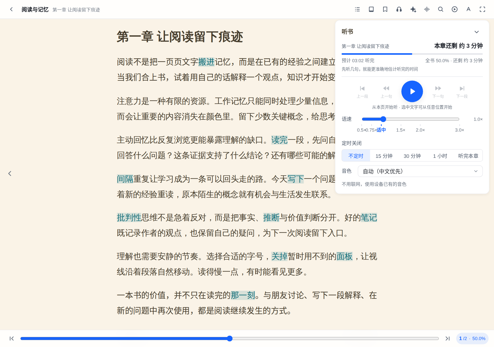
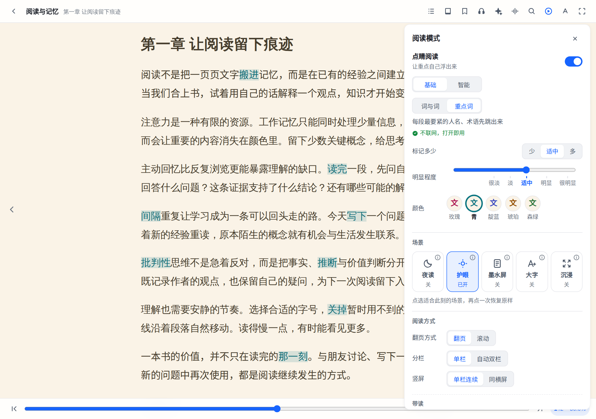
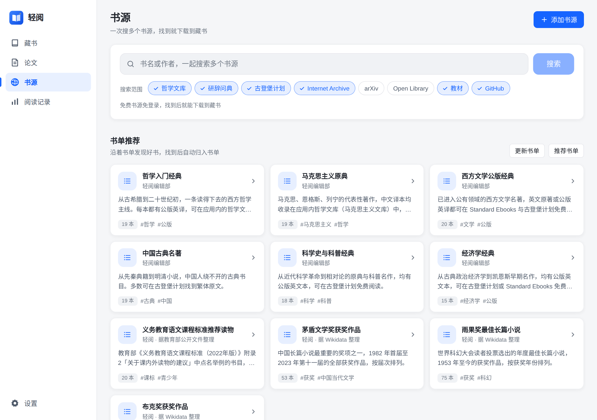

<div align="center">


# LightRead · Open-source ebook & PDF reader

**Turn your reading list into time well spent.**

Bilingual PDF translation · Guided reading · Local library · Booklists · Reading stats · Text to speech

[中文](README.md) · English

[](https://github.com/yzfly/LightRead/releases/latest)
[](https://github.com/yzfly/LightRead/releases)
[](LICENSE)

**[Download LightRead](https://github.com/yzfly/LightRead/releases/latest)** · [Install](#install) · [User guide (中文)](docs/manual/README.md) · [Feedback](https://github.com/yzfly/LightRead/issues)

macOS · Windows · Linux · Web PWA · Android (experimental)

Your books, progress, and notes stay on your device by default. Local reading needs no account or internet connection.



</div>

[PDF translation](#pdf-translation-keep-the-original-in-view) · [Guided reading](#guided-reading-let-the-key-ideas-stand-out) · [Booklists](#booklists-give-your-next-read-a-place) · [Reading stats](#reading-stats-see-your-reading-add-up) · [Listen & focus](#listen--focus-read-at-your-own-pace)

## A local library for the books you want to read

**Drop in a file and start reading.** Organize your collection with covers, tags, booklists, and progress tracking. Research papers have their own library.

Read **EPUB, PDF, MOBI, AZW / AZW3, TXT, and Markdown**, plus FB2, CBZ / CBR comics, DjVu, HTML, and more. KFX and DRM-protected files are not supported.

## PDF translation: keep the original in view

**Original on the left. Translation on the right.** Translate a selection or read page-by-page translations alongside the original layout. On desktop, **BabelDOC** can also generate translated or bilingual PDFs.



Go deeper with the desktop **paper agent and ten-question workflow**. Explore arguments, methods, and evidence while keeping your own answers separate from AI output. [Paper workflow guide (中文) →](docs/paper-reading.md)

<details>
<summary>Translation and AI requirements</summary>

Selection and page translation use the configured AI service. BabelDOC requires desktop, an additional runtime/model download, and a personal model service configuration. Provider fees may apply. The paper agent requires a separately installed and configured Pi, Codex, or Claude Code engine. Scanned PDFs can be displayed, but text selection and text analysis require a text layer; built-in OCR is not provided.

</details>

## Guided reading: let the key ideas stand out

**Dianjing (点睛阅读) adds cues to the original text.** Basic mode marks word boundaries or keywords offline. Smart mode uses AI to identify key sentences, concepts, and contextual notes, with chapter summaries, a book outline, and a skim view for review.



Basic mode is pictured. Smart mode sends text to the selected AI service after consent. Available for reflowable ebooks such as EPUB and TXT, not PDFs or fixed-layout books. [Guided reading guide (中文) →](docs/manual/05-点睛阅读.md)

## Booklists: give your next read a place

**Keep books you own and books you still want in the same list.** Add wanted titles, match them automatically when imported, explore curated lists, and export a list to share.



## Reading stats: see your reading add up

**Today's minutes. This week's books. The habit you're building.** Track a daily goal, reading streaks, weekly/monthly/yearly trends, and a reading calendar.



## Listen & focus: read at your own pace

**Rest your eyes and let the book speak.** Adjust speech speed, set a sleep timer, and resume where you left off. Try typewriter or lyric modes, automatic paging, ambient audio, and night, eye-care, or large-text presets.

| Listen to your books | Find a comfortable reading mode |
| --- | --- |
| [](docs/screenshots/feature-listen.png) | [](docs/screenshots/feature-reading-modes.png) |

Desktop supports online voices, optional downloadable offline models, and system speech. The web version uses system speech. [Speech and ambient audio guide (中文) →](docs/manual/03-声音.md)

## Book discovery: find something worth opening

**Search books, find papers, and explore curated lists in one place.** Connect Project Gutenberg, Internet Archive, arXiv, OPDS / Calibre catalogs, or a self-hosted library.



Enable curated booklists in Settings → Features. Availability, access conditions, and permissions depend on each source. [Self-hosted library guide (中文) →](docs/self-hosted-library.md)

## Pick up on another device

| What you want to do | How LightRead helps |
| --- | --- |
| Continue reading on another device | Optional account sync for progress, notes, bookmarks, booklists, and reading history; import book files separately |
| Sync the files too | Optional WebDAV file sync through your own cloud storage or NAS |
| Send text, links, or files | Transfer via your account, WebDAV, or a temporary pickup code |
| Back up or move your library | Import/export `.okf.zip` library packages; choose a custom storage location on desktop |
| Return to an idea | Highlights, notes, bookmarks, and in-book search |

Local data stays on your device by default. Online sources, speech, AI, and sync connect to their respective services; remote AI receives the relevant text. Library packages exclude app settings, credentials, and agent workspaces. [Sync guide (中文) →](docs/manual/04-使用说明.md#8-多端同步)

## Install

**[Download the latest release →](https://github.com/yzfly/LightRead/releases/latest)** Open **Assets** and choose your platform.

| Platform | Installer suffix |
| --- | --- |
| macOS, Apple Silicon | `aarch64.dmg` |
| macOS, Intel | `x64.dmg` |
| Windows 10/11, 64-bit | `x64-setup.exe` |
| Linux, 64-bit | `.deb`, `.rpm`, or `.AppImage` |
| Android, arm64, experimental | `android_arm64.apk` |

On macOS, open the DMG and drag LightRead into Applications. If blocked, verify the download came from this repository before using the system's **Open Anyway** option. On Windows, run the installer. On Linux, use your package manager or grant execute permission to the AppImage; system library compatibility still applies.

**Android upgrades:** historical builds used different signing keys. If installation conflicts, keep the old app until you have exported and verified a backup outside its private storage. Follow the [migration guide (中文)](docs/installation.md#android实验性) before uninstalling anything.

<details>
<summary>Developers: build from source</summary>

The web frontend needs Node.js. Desktop development also needs Rust and the platform prerequisites for Tauri 2.

```bash
git clone https://github.com/yzfly/LightRead.git
cd LightRead
npm install
npm run dev          # Web development
npm run tauri dev    # Desktop development
```

Build with `npm run build` (frontend) or `npm run tauri build` (desktop). Built with Vue 3, TypeScript, Tauri 2/Rust, foliate-js, and MuPDF/PDFium. See [CLAUDE.md](CLAUDE.md) for development conventions.

</details>

## Help make LightRead better

If LightRead earns a place in your reading routine, **[give it a Star](https://github.com/yzfly/LightRead)**. [Feedback](https://github.com/yzfly/LightRead/issues), pull requests, and lawful public book-source suggestions are welcome.

<sub>Screenshots show the real app with Chinese UI. Library contents, reading history, and PDF translations are demo fixtures. Sample books and covers were made for this feature tour and are not bundled with the app. [Reproduce the screenshots](docs/screenshots/README.md).</sub>

## License and acknowledgments

[GNU AGPL v3.0 or later](LICENSE). Third-party components retain their respective licenses.

Thanks to [foliate-js](https://github.com/johnfactotum/foliate-js), [MuPDF](https://mupdf.com/), [PDFium](https://pdfium.googlesource.com/pdfium/), [BabelDOC](https://github.com/funstory-ai/BabelDOC), [jieba](https://github.com/fxsjy/jieba), and [DeepSeek-R1](https://huggingface.co/deepseek-ai/DeepSeek-R1).
