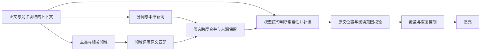

# 点睛信息词算法审查与优化设计

当前最值得做的改进是：保留词库补足概念边界的能力，把重要性判断落实到具体句子和出现位置，再控制高亮的覆盖与重复。词表扩充、换模型和提高密度都不能单独解决“这个词在这里是否重要”。

审查基线为 `v1.18.1`，日期 2026-10-16（美国太平洋时间）。本文包含生产代码审查、可离线复现的反例、2025–2026 年研究比较，以及下一版实验设计。新增候选词库与匹配模块已可运行；生产排序、提示词和缓存协议仍保持原版。

## 现有算法

| 层次 | 当前实现 | 已有价值 |
| --- | --- | --- |
| 中文切词 | `zhSegment.ts`，65,820 词的词表，DAG 最小代价切分，歧义词保守处理 | 本地、快速、原文偏移稳定 |
| 本书新词 | `keyWords.ts / discoverNewWords`，2–4 字片段的 PMI、左右邻熵、边界及短语过滤 | 补书内人名，包括“阿Q”等混合写法 |
| 离线排序 | `S = I + K + 0.5B`；I 是由背景名次估计的稀有度，K 是对背景期望的超额出现，B 是聚集度 | 比单纯词频更能识别本书特色词 |
| 智能选词 | 约 3,000 字一块，模型输出 `kw: q/r`，在原文定位；全书合并相同 q | 能识别统计方法漏掉的长词和概念 |
| 智能排序 | `4r + 2 ln(选中块数) + K + 0.5B` | 综合模型判断与书内证据 |
| 展示约束 | 句内上限、不相邻、一段同词一次、重复减分、首次强调；离线三档 2%/4%/8%，智能 8% 上限，“多”档统计补足 | 控制视觉拥挤、避免连续涂满 |

这里的 I 是词汇稀有度估计，不是“对读者的信息增益”；r 是模型给出的等级，不是校准后的概率。输入法选词频次也不能直接代替二者。基础版和智能版共用排布规则，但候选产生方式不同，评测必须分开。

## 已确认的优化点

### 复合概念的候选边界

运行 `npm run audit:keywords`，可看到基础词表把“主体间性”切成“主体 / 间 / 性”，“先验演绎”切成“先验 / 演绎”，“内圣外王”切成四个字，“可能世界语义学”切成“可能 / 世界 / 语义学”。新增领域词库可以返回这些完整跨度。

这验证的是候选边界问题，不是完整点睛链路的漏选率：当前模型或全书新词发现有时能补回来。词库应作为与统计分词并行的一路候选，不宜把 15 万词全部硬塞进基础切词并赋予“稀有词”高分。这样会改变所有词序、频率、密度分母，还会扩大人名、地名、成语和诗句的噪声。

### 词级判断扩散到不相关语境

审查脚本构造两个原创段落：第一段讨论“存在是本体论的核心概念”，第二段写“这份表格存在一个普通笔误”。给模型词表一个“存在，r=3”，当前生产 `pickSection` 会在两段都高亮“存在”。

原因可从协议直接确认：`prompt.ts` 的 kw 行只有 q/r；`engine.ts` 把各块、各章缓存合并为全书词表，取最大 r 和块数；`keyWordsBook.ts` 的 `aiParas` 只决定段落有没有 AI 结果，没有保留某个词在这个句子中是否被选中。于是词的身份与这一处的重要性混在一起。

改进应优先保留 `sentenceId + quote + occurrence`。书级概念记忆可帮助释义、别名归并、重复衰减，但不能直接授权其他句子的同形词高亮。

### 小说的未来信息隔离不完整

K、B 已用 `limitOrd` 限制到当前章，然而 `buildStats` 的新词发现读取已收集的全书文本。离线反例保持开头“邹七嫂走过门口”不变，仅增加后续章节：切分从“邹 / 七 / 嫂”变为“邹七嫂”。这证明未来文本可以改变前缀的词边界；它本身不等于已测得剧情剧透。

另一个代码路径是 `engine.ts / #loadBookKeyWords`：会合并本书当前版本的所有已缓存重点词，没有按当前阅读位置筛选。因此未来章节缓存也可能改变当前段的优先级。`textTypeInfo` 虽限制了文本范围，估算词/字比例仍使用全书统计。

应定义明确的不变量：小说中，固定当前位置及以前的正文、缓存、设置，任意修改未来章节与未来缓存，当前输出应不变。新词、AI 词、概念别名、章摘要、分母与缓存加载全部服从同一个阅读范围。非小说可以允许全书背景，但局部出现位置仍需判别。是否严格到当前句，或允许当前页上下文，要作为产品规则明确，不能只写“不剧透”。

### 密度和评测口径

固定密度会把不重要的候选补进来；已有智能默认档把密度作为上限是合理基础。还应同时记录“高亮词次数 / 词数”和“高亮字符数 / 正文字符数”：完整长术语增加后，同样的词数密度可能显得更拥挤。不要用切词变少造成的分母变化冒充效果提升。

旧评测覆盖 6 个文本，4 个是小说，另两个是百科式科普和技术文章，哲学、法律、管理等覆盖不足。标注以模型判定为主，仓库没有足以确认独立真人裁决的记录；其 hit 还是按词种标签推广到全部出现位置。旧文档的 0.94 只能解释为该样本、该标注流程、该密度下的结果，不能当成真实读者满意度、所有书类准确率或阅读效率。

旧脚本还有两处应在下轮评测修正：`harness.ts / countOcc` 用 `text.length + word` 作缓存键，不同等长文本会冲突；`eval.ts` 缺少完整标签时把未列出的词按负例计，会惩罚新系统独有的正确候选。新评测按文档 ID 或内容哈希缓存，未评词单列并补审，不直接当错。

## 较新方法的适配判断

| 方法与来源 | 对点睛有用的部分 | 采用顺序与限制 |
| --- | --- | --- |
| [COLING 2025 混合提示抽取](https://aclanthology.org/2025.coling-main.248/) | 自由抽取与候选筛选互补；完整论文先分别生成，再合并候选并进行第三次推断 | 优先研究。第一步试“正文 + 少量领域候选 + 允许补选”的单次调用，属于我们的低成本变体，并非论文方法的已验证等价替代；必要时再比较三阶段版 |
| [Attention-Seeker 2025](https://aclanthology.org/2025.coling-main.335/) | 用模型内部注意力动态评估候选，值得作为长文候选排序基线 | 当前聊天 API 不提供所需注意力图，落地需可访问内部状态的本地或自托管模型；注意力也不等于读者理解收益 |
| [Attention Expansion 2026](https://arxiv.org/abs/2606.10716) | 为窗口内编码表示补充周围窗口的信息，减少长文分块丢失语境的问题 | 2026 年 6 月预印本，值得作为后续轻量序列标注模型路线。论文评测科学与新闻语料，尚不能推断中文电子书效果；小说只能使用允许阅读范围内的信息 |
| [NAACL 2025 专项指令与多次采样聚合](https://aclanthology.org/2025.findings-naacl.439/) | 多次判断有助于发现分歧，可用作离线标注、难例复核 | 请求与 token 成本增加；优先用于评测或低置信度块，不默认每页多次调用 |
| [MAPEX 2025](https://arxiv.org/abs/2509.18813) | 根据文档长度区分抽取路径，加入主题引导与候选后处理 | 预印本的多 Agent 流程适合离线比较；实时阅读先验证收益是否超过额外延迟与费用 |
| [Scim](https://arxiv.org/abs/2205.04561) | 阅读辅助需要同时考虑重要性、多样性、文中分布和读者控制 | 用于确定产品目标与用户实验；它面向论文句子高亮，不能把效果直接搬到中文重点词 |

因此推荐路线是“词库候选 + 局部语境抽取 + 受约束的选择”。纯 TF-IDF、TextRank 可保留为简单基线；单一全文向量中心度不擅长保留少见而关键的转折、反例和新定义；端到端多 Agent 暂不作为默认实时方案。是否更好取决于点睛自己的对照评测，而非论文排行榜名称。

## 建议的下一版结构

**候选层。** 每项包含原文起止位置、候选来源、所属领域、可选概念 ID。全量保留来源词头，但只检索当前领域和当前块；允许长词与嵌套子词同时成为候选，由上下文决策。22 类用于单一主路由和覆盖检查，交叉领域作为附加标签，避免概念被强行切成互不相干的学科。错误分类不得禁止模型自由抽取。

当前实验模块使用惰性前缀树，避免对每个词重复扫描整段正文，保存每次出现的独立跨度。`hints()` 的前 24 词只是可复现的提示预算基线，按原文顺序，不是重要性排序；长块的早部偏置需在实验中与按段分配候选预算比较。词频不参与加分。

**语境层。** 智能版下一协议建议输出 `{"t":"kw","s":"2.3","q":"主体间性","r":3}`；同一句重复出现时再增加第几处或短锚点，通过客户端匹配得到最终偏移，避免让模型数 Unicode 字符。模型仍看正文，可以拒绝所有词库候选，也可以补选词库没有的词。定义、因果、对比、转折、论证依赖是判断线索，不能仅凭“在术语库中”入选。否定与条件不可被断章取义地省略；必要时交给已有要句层表达完整含义。

离线版先实验词库跨度与现有统计信号的组合，分开“完整成词的可信度”和“这一处的重要性”。在有人审的出现位置标签之前，不替换现有排序权重。更长期可用强模型加人工审核产生训练数据，蒸馏为较小的序列标注或交叉编码模型；真实部署前测 WebView 内存、冷启动、离线速度和耗电。

**选择层。** 候选语境分数经过验证集校准后，以最低质量门槛过滤，再在词数/字符预算内兼顾概念覆盖、首次定义、章节新信息、同义重复和相邻拥挤。可以从带覆盖奖励的贪心选择开始：每次选择新增价值最大的原文跨度，价值不足就停止，不为凑百分比填满。重要定义再次出现或主题切换时允许重亮，重复衰减不必单纯随全书次数一直加重。

**状态与缓存。** 书级概念记忆、当前块判断、最终高亮结果分开存。缓存包含模型、提示版本、正文哈希、词库版本、排序版本和阅读范围；新旧协议明确隔离。旧版无 s 的 kw 保持原兼容策略或退回离线，不能装成已定位的新版输出，也不能因新增词库默默重新计费。自带密钥路径继续本地检索并直连用户选择的模型，内置路径由 relay 使用相同数据版本；不为查词库把自带密钥用户的正文额外送到平台。

## 对照实验与上线门槛

1. **先补基准。** 以书为单位划分训练、验证和测试，不能把同一本书的不同章随机分到两边。按 22 类建立覆盖矩阵，首批重点补哲学、中华思想、自然辩证法、法律、经济管理；保留小说和专业技术的难例，加入未出版的原创短文以减轻模型记忆影响。每个主类先取至少 3 本、每本 5 个有上下文的片段作为启动规模，达不到的类明确空缺。
2. **标具体位置。** 标注完整词边界、这一处是否值得亮、是否属核心概念、否定/条件是否完整。至少两位独立读者复核抽样和分歧；模型标注只作辅助标签。词库候选召回与最终高亮质量分别统计；报告未评候选比例。
3. **做消融。** A 为现有离线，B 为现有 AI，C 为 AI 加领域候选，D 为 C 加出现位置约束，E 为 D 加覆盖与重复选择。另设仅靠词库、全域词库、完整三阶段混合抽取，识别收益究竟来自哪里。先复用缓存与离线反例，再安排有明确调用上限的在线评测。
4. **主指标。** 固定高亮字符预算下，比较出现位置精确率、核心概念召回、按书/学科宏平均、边界错误率、普通同形词误亮率、重复比例与未定位率。报告按书 bootstrap 的区间，避免频繁人名把总体分数抬高。必须满足未来文本/缓存不变性测试、原文跨度合法与无重叠。
5. **成本与体验。** 记录首屏及后续块 p50/p95 延迟、每万字 token/费用、内存峰值、离线回退。再做盲测阅读任务：理解正确率、定位答案时间、干扰感和“不是重点”的反馈。只有抽取指标改善不能声称阅读理解改善。

优先实现顺序：明确小说阅读范围并补状态隔离 → 带句子位置的 kw 协议 → 词库候选对照 → 选择层实验 → 小模型蒸馏或注意力方法。每一步独立比较与回滚；尚无代表性对照结果时保持现有生产行为。

## 已有可复核交付

- `src/data/terminology/`：11 类 THUOCL 完整词头、Wikidata 哲学快照、自编核心词，156,965 个去重写法；逐来源许可、SHA-256、异常行、分类覆盖报告。
- `src/services/terminology.ts`：未接入生产的候选路由与原文跨度匹配，提供后续实验共同输入。
- `scripts/audit-keyword-candidates.mjs`：使用生产函数复现词边界、同形词跨语境和未来新词影响；原创合成反例不用于声称总体准确率。
- `scripts/test-terminology.mjs`：数据完整性、许可清单、异常频次、分类、嵌套词、ASCII 边界、长度与预算约束验证。

两类官方中文术语资料已纳入来源与领域设计，完整再分发尚缺适用许可或数据接口授权，详见[数据说明](../../src/data/terminology/README.md)。本轮没有额外付费模型调用，也没有将候选覆盖率当作高亮质量提升。

本地验证：新增词库契约 11 项、现有重点词 12 项、点睛 28 项均通过，类型检查与生产构建通过；连续重建的数据 SHA-256 一致。Linux / Node 24.19.0 的单次微基准中，完整数据读取、解析、校验约 85 ms，医学领域 3,000 字首次匹配约 60 ms，随后 100 次匹配 p50 约 2.20 ms、p95 约 3.77 ms。此结果只说明本机实验成本，不能当作手机指标；正式接入需放在 Worker 中惰性加载并测冷启动内存。
